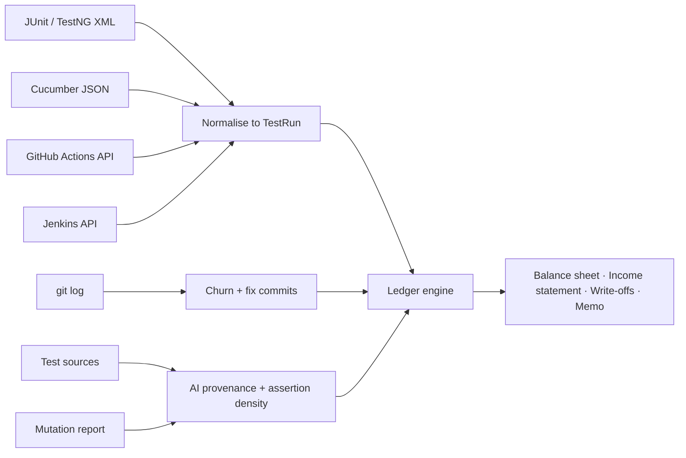

# TestLedger — Test Estate Balance Sheet

[](https://github.com/surkuar/testledger/actions/workflows/ci.yml)
[](LICENSE)
[](pyproject.toml)
[](action.yml)

> **Your test suite is a portfolio. TestLedger is its balance sheet.**
> Every automated test carries a cost (CI minutes, reruns, engineer triage, maintenance churn) and produces a return (regressions caught before production). TestLedger books both from the data you already have — CI results and git history — and produces a one-page **Quality Investment Memo** that a VP of Engineering or CFO can act on.

Most tooling in this space stops at "which tests are flaky". TestLedger answers the question leaders actually ask: **which tests are worth what we pay for them, and where should the next dollar of QE effort go?**

---

## What you get

| Artefact | Audience | What it says |
|---|---|---|
| `memo.md` / `memo.html` | VP Eng, CFO, Director of QE | Bottom line, reallocation recommendation, where the money goes, top liabilities/assets, assumptions |
| `balance_sheet.json` | QE leads | Assets vs. liabilities per test, by pyramid layer, by suite |
| `income_statement.json` | Finance / QE leads | Cost by category (CI, reruns, triage, maintenance) vs. value delivered |
| `writeoffs.json` | Team leads | The action list: **retire / demote / fix / quarantine**, each with a reason |
| `ai_liabilities.json` | QE governance | AI-generated tests that fail mutation-score or assertion-density thresholds ("test theater") |
| `ledger.json` | Dashboards | The full book — diff it quarter over quarter |
| PR comment / job summary | Engineers | Compact table posted by the GitHub Action |

**See a real one:** [sample memo (Markdown)](docs/sample-report/memo.md) · [HTML version](docs/sample-report/memo.html) · [write-off list](docs/sample-report/writeoffs.json) — generated from the built-in demo in under a second.

## Quick start (any OS — Windows, macOS, Linux)

```bash
pip install git+https://github.com/surkuar/testledger.git
# or, from a clone:  pip install -e .

# 1. Try the built-in demo (fake repo, 12 weeks of CI history, reruns, a real regression, an AI-written test)
python examples/generate_demo.py demo-estate
cd demo-estate
testledger analyze --config testledger.yml --reports . --mutation mutation.json --out reports
testledger memo reports            # print the memo
start reports/memo.html            # Windows  (macOS: open, Linux: xdg-open)

# 2. On your own repo
testledger init                    # writes testledger.yml with documented defaults
testledger analyze --config testledger.yml --reports path/to/ci-reports --out testledger-out
```

### Compare two saved ledgers

```bash
testledger diff q3/ledger.json q4/ledger.json --out diff.md
testledger diff q3/ledger.json q4/ledger.json --json
```

The comparison shows portfolio totals and verdict counts, tests added or removed,
verdict changes, and the ten largest net changes among tests in both ledgers.
It shows each report's generation timestamp and flags mismatched window lengths.
Review changes in the window length, rates, and thresholds before comparing cost or value.

### Local report folder convention
TestLedger needs to know which CI runs re-executed the **same commit** — that is how flakiness is detected without any test-framework changes. For local folders, name each run directory:

```
ci-reports/
  20260915-066b939951-attempt1/TEST-results.xml      # <YYYYMMDD>[THHMM]-<sha>-attempt<N>
  20260915-066b939951-attempt2/TEST-results.xml      #   same SHA, attempt 2 => a rerun
  20260917-17f9d0b9e0-attempt1/cucumber.json
```
When you use the GitHub Actions or Jenkins ingesters this metadata comes from the CI API automatically.

## Inputs supported (v1)

| Source | How | Notes |
|---|---|---|
| JUnit XML (Surefire, Gradle, pytest, Jest, …) | `sources.junit_globs` | universal baseline |
| TestNG `testng-results.xml` | `sources.junit_globs` | auto-detected |
| Cucumber JSON (jvm / ruby / js) | `sources.cucumber_globs` | scenario = test, outline rows distinct |
| Allure results (JUnit 5, TestNG, pytest, Playwright, …) | `sources.allure_globs` | one `allure-results/` folder = one run; retries (same `historyId`) = reruns |
| Git history | `sources.git_repo` | maintenance churn on test files; fix-commit detection for value credit |
| GitHub Actions | `sources.github` | run history + artifacts via REST API, `run_attempt` = rerun |
| NUnit 3 XML | `sources.junit_globs` | `TestResult.xml`; NUnit 2 exports are rejected with an explicit error; NUnit has no source path, so `file` is approximated from the class namespace (`Shop.Tests` becomes `Shop/Tests.cs`) |
| Jenkins | `sources.jenkins` | build history + `testReport` JSON; same SHA in consecutive builds = rerun |
| Azure DevOps Pipelines | `sources.azure_devops` | builds + test runs via REST API (`api-version=7.1`); repeated test runs on one build or SHA = reruns |
| Mutation reports | `--mutation` | PIT XML, Stryker JSON, or `{file: score}` JSON |

## How it works (short version)



**Debits (cost) per test:** CI minutes × rate · rerun minutes · flaky false-alarms × triage minutes × engineer rate · test-file lines changed × maintenance minutes × engineer rate.

**Credits (value) per test:** a genuine first-attempt failure (not cleared by a same-SHA rerun) followed within 3 days (`thresholds.fix_window_days`) by a product-code commit that looks like a fix, valued at your organisation's cost of a production defect.

**Verdicts:** `quarantine` (flake ≥ 30 %) · `retire` (no catches, net negative, cost above floor) · `demote` (UI test whose cost-per-catch is ≥ 3× the service-layer median) · `fix` (valuable but flaky or slow) · `asset` · `hold`.

Every rate and threshold lives in `testledger.yml` and is printed on the memo so finance can challenge it. Full derivation: **[docs/methodology.md](docs/methodology.md)**. Architecture and flowcharts: **[docs/design.md](docs/design.md)**.

## Use as a GitHub Action

```yaml
# .github/workflows/testledger.yml
name: TestLedger
on:
  schedule: [{ cron: "0 6 * * 1" }]   # weekly memo
  pull_request:
permissions:
  contents: read
  actions: read
  pull-requests: write
jobs:
  ledger:
    runs-on: ubuntu-latest
    steps:
      - uses: actions/checkout@v4
        with: { fetch-depth: 0 }           # full history for churn / fix detection
      - uses: surkuar/testledger@v0.1.0
        with:
          config: testledger.yml
          reports: build/test-results      # or leave empty and configure sources.github
          fail-on-quarantine: "false"
```
The action uploads all reports as an artifact, appends the memo to the job summary, and keeps one live comment on each PR.

## Configuration

`testledger init` writes a fully commented file. The important parts:

```yaml
org_name: Acme Commerce
window_days: 90
rates:
  engineer_hourly_usd: 75        # fully loaded
  ci_minute_usd: 0.008
  triage_minutes_per_false_alarm: 18
  maintenance_minutes_per_line: 1.5
  regression_value_usd: 2000     # cost of one escaped defect — your number
thresholds:
  quarantine_flake_rate: 0.30
  fix_flake_rate: 0.10
  slow_test_seconds: 60
  demote_layer_cost_ratio: 3.0
  retire_min_cost_usd: 25
  ai_min_mutation_score: 0.5
  ai_min_assertion_density: 0.8
sources:
  junit_globs: ["**/surefire-reports/*.xml", "**/TEST-*.xml"]
  cucumber_globs: ["**/cucumber*.json"]
  git_repo: "."
  github: { repo: "acme/shop", workflow: "ci.yml", token_env: "GITHUB_TOKEN", max_runs: 200 }
  jenkins: { url: "https://ci.acme.com", job: "shop/main", user_env: "JENKINS_USER", token_env: "JENKINS_TOKEN" }
  azure_devops: { org_url: "https://dev.azure.com/acme", project: "shop", definition: 12, token_env: "AZURE_DEVOPS_TOKEN" }
```

## Why this exists

Engineering leaders are routinely told to present automation "as risk-adjusted ROI" — but nothing computes it from real data. Flaky-test tools price flakes; ROI calculators take hand-typed guesses; the test-portfolio idea lives in blog posts. TestLedger closes that gap: it is the first open-source tool that treats a test estate as a managed portfolio with per-test P&L, a balance sheet, and an executive memo — framework-agnostic, CI-agnostic, and runnable in two minutes on any OS.

It was built by a QE leader for QE leaders. If you run a quality organisation and need to defend (or reallocate) a testing budget, this is the number you were missing.

## Development

```bash
pip install -e ".[dev]"
pytest                     # 25 tests, offline (CI APIs stubbed; git tests use a throwaway repo)
ruff check src tests
```

## Roadmap
- [ ] GitLab CI ingester
- [x] Azure DevOps ingester
- [ ] Code-ownership join (CODEOWNERS) so the memo is grouped by team
- [x] Quarter-over-quarter diff (`testledger diff q3.json q4.json`)
- [ ] Optional LLM narrative for the memo (opt-in, local or API)
- [ ] Web dashboard reading `ledger.json`

## License
MIT © Suresh Babu. See [LICENSE](LICENSE).
