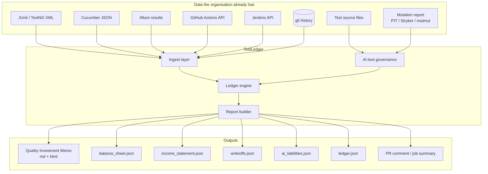
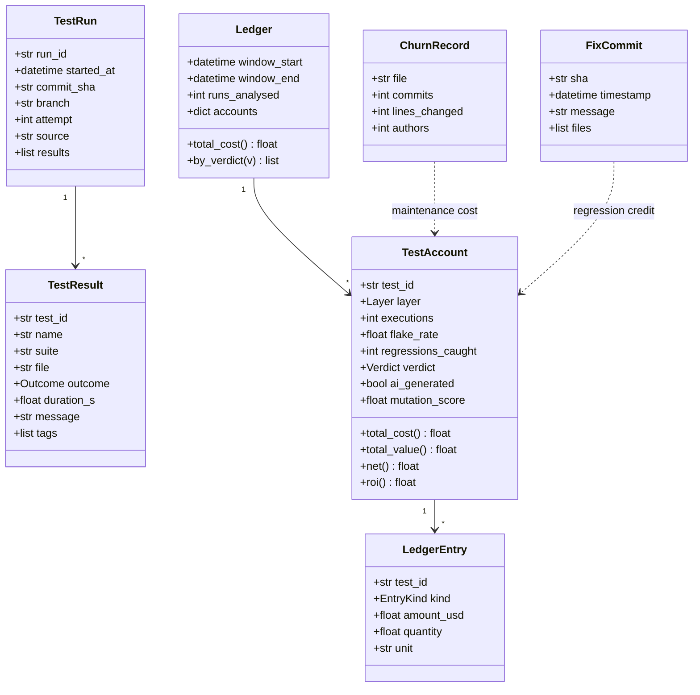
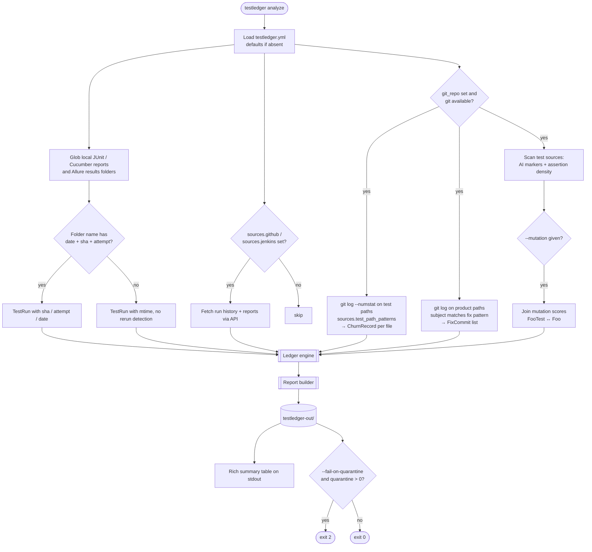
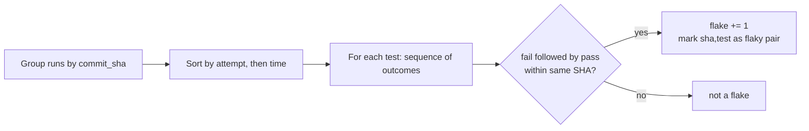
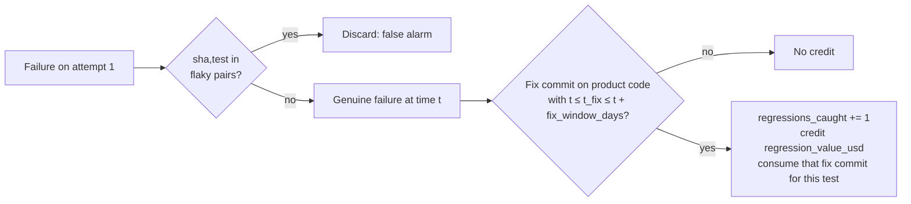
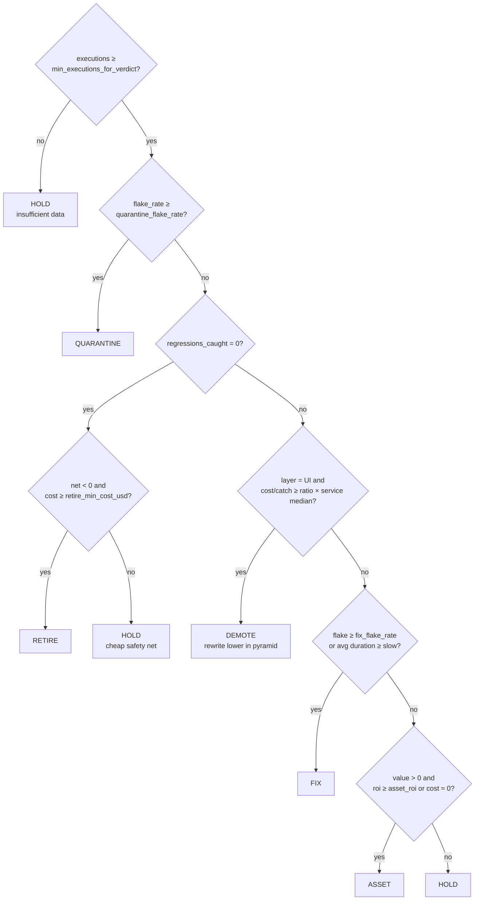
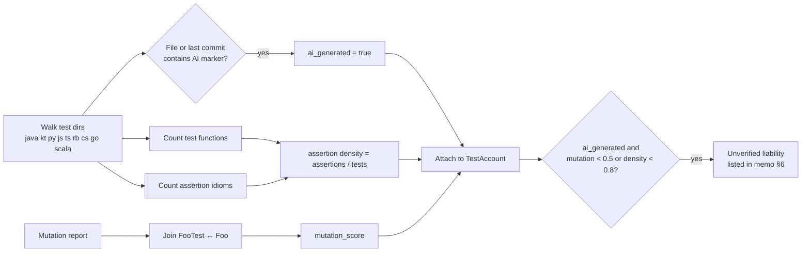
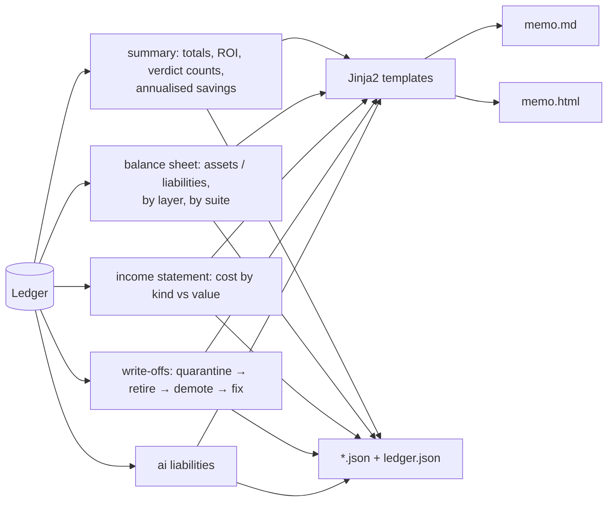
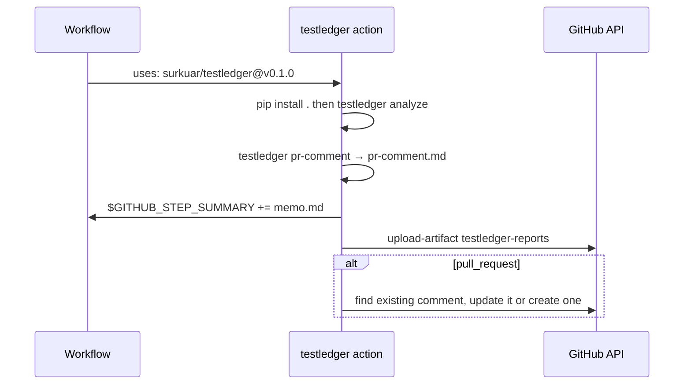

# TestLedger — Design Document

*Architecture, data flow, decision logic, and technology choices.*
*All diagrams are Mermaid and render natively on GitHub.*

---

## 1. Problem statement

Quality-engineering leaders cannot answer, with data, three questions their executives ask:

1. **What does our test estate cost us?** — not the CI bill, but the full carrying cost including engineer time lost to flaky failures and test maintenance.
2. **What is it worth?** — which tests have actually stopped a defect reaching production.
3. **Where should the next dollar go?** — retire, rewrite at a cheaper layer, stabilise, or protect.

Existing tools detect flaky tests or ask leaders to type guesses into an ROI calculator. TestLedger computes the answer from data the organisation already has: CI results and git history.

## 2. Goals and non-goals

| Goals | Non-goals (v1) |
|---|---|
| Framework-agnostic (JUnit, TestNG, Cucumber, pytest, Jest …) | Replacing a test-management system |
| CI-agnostic (local folders, GitHub Actions, Jenkins) | Real-time dashboards (the JSON output feeds those) |
| Zero changes to test code or pipelines | Precise accounting — the model is *comparative*, not an invoice |
| Platform-independent (Windows/macOS/Linux, Python ≥ 3.11) | Deep static analysis of test code |
| Executive-readable output | Auto-deleting tests (humans decide; the tool recommends) |
| Every assumption visible and overridable | |

## 3. System context



## 4. Component architecture

```
src/testledger/
├── cli.py                 Typer CLI: init · analyze · memo · pr-comment
├── config.py              testledger.yml schema (pydantic) — rates, thresholds, sources
├── models.py              Domain model: TestRun, TestResult, ChurnRecord, FixCommit,
│                          LedgerEntry, TestAccount, Ledger, Verdict
├── ingest/
│   ├── junit.py           JUnit / Surefire / TestNG XML → TestRun
│   ├── cucumber.py        Cucumber JSON → TestRun
│   ├── allure.py          allure-results/ folder → TestRun (+ one per retry round)
│   ├── gitlog.py          git log → churn per test file, fix commits on product code
│   ├── github_actions.py  REST client: runs → artifacts → zip → TestRun (with run_attempt)
│   └── jenkins.py         JSON API: builds → testReport → TestRun (same SHA = rerun)
├── ledger/
│   └── engine.py          Books debits/credits per test, detects flakes, credits
│                          regressions, assigns verdicts
├── aitest/
│   └── detector.py        AI provenance markers, assertion density, mutation-score join
├── reports/
│   └── builder.py         Balance sheet, income statement, write-offs, memo, ledger.json
└── templates/
    ├── memo.md.j2         Markdown memo
    └── memo.html.j2       Self-contained HTML memo
```



## 5. End-to-end pipeline



## 6. Ledger engine logic

### 6.1 Flake detection (no framework changes needed)

A flake is a **same-commit fail → pass transition**. CI systems rerun the same SHA (GitHub `run_attempt`, Jenkins "rebuild"); that rerun is the only ground truth that nothing changed.



### 6.2 Regression credit



Design choices:
* **Only attempt-1 failures count.** A failure that only shows on a rerun is noise.
* **A fix commit can be consumed once per test** so a single fix does not credit the same test repeatedly, but *can* credit several tests that all failed on it (they all provided signal).
* **Fix window** is `thresholds.fix_window_days` in `testledger.yml` (default 3 days, the typical fix lead time on a red main branch). Raise it for weekly release trains, lower it if fixes land within hours. It is printed in the memo's assumptions.
* **Fix pattern** is `sources.fix_commit_pattern` in `testledger.yml`, a case-insensitive regex matched against the commit subject. The default is `\b(fix|fixes|fixed|bug|hotfix|regression|defect|patch)\b`, so conventional-commit `fix:` prefixes match naturally. Teams using incident-ticket prefixes can set e.g. `^INC-\d+`. An invalid regex is rejected when the config loads.

### 6.3 Booking entries

| Kind | Side | Formula |
|---|---|---|
| `ci_compute` | debit | Σ duration (min) × `ci_minute_usd` |
| `rerun_compute` | debit | executions on attempt > 1 × avg duration (min) × `ci_minute_usd` |
| `triage_time` | debit | flakes × `triage_minutes_per_false_alarm` / 60 × `engineer_hourly_usd` |
| `maintenance` | debit | (lines changed in test file ÷ tests sharing the file) × `maintenance_minutes_per_line` / 60 × `engineer_hourly_usd` |
| `regression_caught` | credit | regressions_caught × `regression_value_usd` |
| `risk_coverage` | credit | optional flat `risk_coverage_value_usd` for stable tests (default 0) |

### 6.4 Verdict decision tree



### 6.5 Layer classification

Substring rules in `testledger.yml → layers` map a test id or path to `unit | service | ui`. Defaults recognise `unit`, `/test/`, `api`, `integration`, `contract`, `ui`, `e2e`, `selenium`, `playwright`, `cucumber`, `features/`. UI is checked first because UI paths often also contain "test".

## 7. AI-generated test governance



Rationale: high line coverage with low mutation score is the signature of an assertion that mirrors the implementation ("test theater"). A test that cannot fail on a real defect is pure carrying cost; AI generators produce these at scale, so they get their own section in the memo.

## 8. Report builder



Annualised savings = (cost of retire + quarantine tests in window) × 365 / window_days; demote savings assume the rewritten test costs 1/`demote_layer_cost_ratio` of the original.

## 9. GitHub Action

Composite action (`action.yml`): sets up Python, installs the package from the action path, runs `analyze`, writes `pr-comment.md`, appends the memo to `$GITHUB_STEP_SUMMARY`, uploads the output folder as an artifact, and upserts one PR comment (found by its heading, so it never spams).



## 10. Technology choices

| Concern | Choice | Why |
|---|---|---|
| Language | **Python 3.11+** | Ships on every OS, `pip install` is the lowest-friction adoption path, excellent XML/JSON/subprocess stdlib |
| CLI | **Typer** + **Rich** | Typed options, auto help, readable terminal tables; `CliRunner` makes the CLI unit-testable |
| Validation | **pydantic v2** | Config and domain models validated at the boundary; JSON dump for free |
| Config | **YAML** (PyYAML) | Human-editable, comment-friendly, familiar to CI users |
| Templates | **Jinja2** | Markdown and HTML memo from one context; autoescape for HTML |
| HTTP | **requests** | Minimal, well known; clients accept an injected `session` so tests run offline |
| Git | **`git` CLI via subprocess** | No native dependency, identical behaviour on Windows/macOS/Linux, works with any git version |
| XML | **`xml.etree`** (stdlib) | No lxml build step; JUnit/TestNG dialects are simple |
| Packaging | **setuptools + pyproject** | `pip install git+…` works; wheel built in CI |
| Quality | **pytest**, **ruff**, **mypy**, **CI matrix 3 OS × 3 Python** | Proves platform independence on every push |
| Distribution | PyPI-ready package + composite GitHub Action | Two adoption paths: CLI anywhere, zero-config in Actions |

## 11. Platform independence checklist

* No path string concatenation — `pathlib` everywhere; globs via `glob(recursive=True)`.
* All file I/O specifies `encoding="utf-8"` (Windows default is not UTF-8).
* Git invoked as `git -C <repo> …` with `errors="replace"` so non-UTF-8 commit messages never crash.
* No shell features in subprocess calls (argument lists, `shell=False`).
* Timestamps are timezone-aware UTC throughout; naive timestamps are coerced.
* CI matrix runs the full demo on Windows, macOS and Linux.

## 12. Extension points

| Want to… | Do this |
|---|---|
| Add a CI system (GitLab, Azure DevOps) | New module in `ingest/` returning `list[TestRun]`; wire into `cli._load_ci_runs` |
| Add a result format (Allure, NUnit) | New parser returning `TestRun`; add glob to `Sources` |
| Change the cost model | `ledger/engine.py → build_ledger` books entries; add an `EntryKind` |
| Change verdict rules | `ledger/engine.py → _assign_verdicts`; thresholds in `config.Thresholds` |
| Re-skin the memo | `templates/memo.*.j2` |
| Feed a dashboard | Consume `ledger.json` (stable schema: `summary`, `assumptions`, `accounts[].entries[]`) |

## 13. Security and privacy

* Tokens are read only from environment variables named in config — never stored in files or output.
* Output contains test ids, durations, costs; no source code, no secrets.
* The GitHub Action needs `actions:read` (history) and `pull-requests:write` (comment) only.

## 14. Limitations (honest list)

* Value is credited only when a fix commit is detectable; teams that squash-merge without "fix" wording will under-count value — set `sources.fix_commit_pattern` or use conventional commits.
* Maintenance churn is apportioned evenly across tests in a file.
* Mutation-score join is by file-stem convention (`FooTest` ↔ `Foo`); unusual layouts need a manual `{file: score}` JSON.
* The model is comparative: use it to rank and reallocate, not to invoice.
